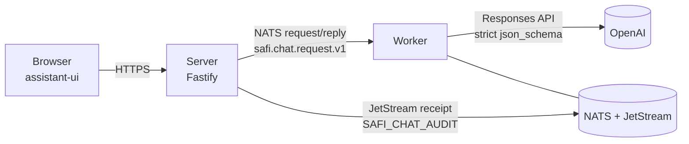

# SAFI Chat 020 — Structured JSON Chat over NATS to OpenAI

## What this product does

SAFI Chat is a small web chat. You sign in, pick one of two **reply formats** (a short *summary*, or a *task list*), and
talk to an AI model. Every answer you see has been checked, field by field, against a fixed JSON schema before it reaches
the screen. If the model returns something that does not match, you see a red **REJECTED** card instead of a fake
success. Under each answer the page shows which schema (ID, version, SHA-256 digest) was used and whether validation passed.

Behind the page, the message does not go straight to the AI. It travels through a real message bus (NATS):

```
 Browser (assistant-ui chat)
    │  HTTPS  (cookie login, CSRF header, strict request validation)
    ▼
 Server (Fastify)  ── validates input, binds fixed test GUIDs/context, applies rate + call caps
    │  NATS core request/reply   subject safi.chat.request.v1   (30 s deadline)
    ▼
 Worker (Node)     ── picks the approved schema, calls OpenAI Responses API (strict structured output),
    │                  re-validates the result with Ajv, replies with a typed result or typed error
    ▼
 OpenAI API  (gpt-6-luna by default)

 Server ──► NATS JetStream stream SAFI_CHAT_AUDIT (redacted receipt, 7-day retention) before answering the browser
```



What it is **not**: it is a one-pilot-user demonstration of the SAFI Chat standard, not a production chat product (see
[Scope limits](#scope-limits)). The wire format is documented in `docs/CONTRACTS.md`, the browser API in `openapi.yaml`,
and the requirements in `docs/SOW-020.md`.

## Quick start (about 30 minutes, README only)

### 0. Prerequisites

| Need | Why | Check |
|---|---|---|
| Node.js 22+ (24 recommended) and npm | build and run | `node -v` |
| Git | clone | `git --version` |
| Docker + Docker Compose v2 | run NATS (and optionally everything) | `docker compose version` |
| An OpenAI API key with access to `gpt-6-luna` and a spend cap | real answers | platform.openai.com |
| A pilot username and password you choose | login | — |

Without an OpenAI key you can still run the whole automated test-suite and the browser end-to-end test: they use a fake
upstream that is part of the tests only. A real conversation and `npm run verify:live` need the real key.

### 1. Install and test (5 min)

```bash
git clone <this repository> safi-chat-020 && cd safi-chat-020
npm ci
npm run test              # unit, contract, server and worker tests; no Docker, no OpenAI needed
```

`npm run test` first runs `npm run nats:fetch` automatically (a `pretest` step): it downloads the pinned nats-server
v2.11.17 into `.tools/` on first use, verifies its SHA-256 against the digest pinned in `scripts/fetch-nats-server.mjs`
(taken from the release's `SHA256SUMS`) and aborts loudly on a mismatch. It does nothing if `TEST_NATS_URL` is set.

### 2. Configure (3 min)

```bash
cp .env.example .env      # Windows PowerShell: Copy-Item .env.example .env
```

Edit `.env` and set at least:

| Variable | Meaning | Default / limit |
|---|---|---|
| `PILOT_USERNAME`, `PILOT_PASSWORD` | the single login (password at least 12 characters) | required |
| `SESSION_SECRET` | signs session cookies, at least 32 random characters | required |
| `SESSION_TTL_MIN` | session lifetime | 120 |
| `OPENAI_API_KEY` | worker only; never sent to the server container or browser | required for real answers |
| `OPENAI_MODEL` | model name | `gpt-6-luna` |
| `OPENAI_BASE_URL` | leave empty for real OpenAI; anything else marks the stack "custom" | empty |
| `OPENAI_TIMEOUT_MS` | per-call timeout | 25000 |
| `MAX_OUTPUT_TOKENS` | model output cap | 512 (max 512) |
| `USER_RATE_PER_MIN` | requests per minute per user | 10 (max 10) |
| `PILOT_API_CALL_CAP` | total OpenAI calls the pilot may use; persisted in `DATA_DIR/usage.json`; calls that were never delivered to the worker are refunded | 40 |
| `MAX_INPUT_CHARS`, `MAX_TURNS`, `BODY_LIMIT_BYTES` | input caps | 4000, 8, 16384 |
| `NATS_URL` | where server and worker find NATS | `nats://127.0.0.1:4222` |
| `NATS_USER`, `NATS_PASS` | NATS authentication (enabled in compose when `NATS_USER` is set). Set `NATS_PASS` to a random value; with the dev override NATS listens on loopback and any local process could otherwise publish requests and bypass the server's caps | `safi` / placeholder |
| `TLS_CERT_FILE`, `TLS_KEY_FILE` | HTTPS certificate for the server | `./infra/certs/dev.*` |
| `HOST`, `PORT` | listen address | `0.0.0.0`, `8443` |
| `TRUST_PROXY_HOPS` | number of trusted reverse-proxy hops (0 = none: `X-Forwarded-For` is ignored). Use `1` for the caddy profile or `npm run share:tunnel`. Only safe when clients cannot reach the server port directly (compose binds it to `127.0.0.1`) | `0` |
| `ALLOW_PLAIN_HTTP_BEHIND_PROXY` | serve plain HTTP when no `TLS_CERT_FILE`/`TLS_KEY_FILE` is set; only behind a TLS-terminating proxy. TLS is otherwise mandatory, and is independent of `TRUST_PROXY_HOPS`. Cookies stay `Secure` | `false` |
| `DATA_DIR` | usage counter location | `./data` |
| `SAFI_DOMAIN` | public domain for the `caddy` profile | empty |

Create a development certificate (self-signed, `localhost` only):

```bash
npm run certs:dev
```

### 3. Run it — the SOW §8 operator sequence

Run every command from the **repository root** (the one containing `package.json`). There are two alternative ways to
run the stack. **Pick one**: both serve <https://localhost:8443>, so they cannot run at the same time.

| Step | Path A: everything in Docker | Path B: NATS in Docker, server and worker from source |
|---|---|---|
| 1. install | `npm ci` | `npm ci` |
| 2. test | `npm run test` | `npm run test` |
| 3. configure | copy `.env.example` to `.env`, edit it, then `npm run certs:dev` (once) | same |
| 4. start | `npm run stack:up:dev` | `npm run stack:nats` |
| 5. build | (the images build themselves) | `npm run build` |
| 6. run | (already running) | `npm run start` (leave it running; Ctrl+C stops worker and server) |
| 7. check | `curl -k https://localhost:8443/healthz` gives `{"ok":true}` | same |
| 8. verify live | `npm run verify:live` (see step 4 below) | same |
| stop | `npm run stack:down` | Ctrl+C, then `npm run stack:down` |

What the npm scripts expand to (use these directly if you prefer; `--env-file .env` is required, otherwise Compose looks
for `infra/.env` and `NATS_USER`/`NATS_PASS` never reach the NATS container):

```bash
# stack:up:dev (Path A)  - NATS, worker and server in containers, NATS also on 127.0.0.1:4222
docker compose --env-file .env -f infra/docker-compose.yml -f infra/docker-compose.dev.yml up -d --build
# stack:nats (Path B)    - only NATS, JetStream on, published on 127.0.0.1:4222 (authenticated)
docker compose --env-file .env -f infra/docker-compose.yml -f infra/docker-compose.dev.yml up -d nats
# stack:down
docker compose --env-file .env -f infra/docker-compose.yml -f infra/docker-compose.dev.yml down
# stack:up (Path A without the NATS port; then verify:live cannot read NATS and marks A03/A13 BLOCKED)
docker compose --env-file .env -f infra/docker-compose.yml up -d --build
```

Notes:

* The server port is published on `127.0.0.1:8443` only. Expose it publicly through the `caddy` profile or
  `npm run share:tunnel` (below), never by editing the port to `0.0.0.0`.
* The `.env` value `NATS_URL=nats://127.0.0.1:4222` is for host-side tools (Path B and `verify:live`); inside Docker the
  compose file points the containers at `nats://nats:4222` itself.
* If your OpenAI endpoint is a local mock on the host, use `OPENAI_BASE_URL=http://host.docker.internal:<port>/v1`
  (containers) or `http://127.0.0.1:<port>/v1` (Path B). Any non-empty value marks the stack "custom" and makes
  `verify:live` BLOCKED; leave it empty for the real API.
* Individual services can be stopped on their own, for example
  `docker compose --env-file .env -f infra/docker-compose.yml stop worker`.

Open <https://localhost:8443>. Your browser warns about the self-signed certificate; that is expected for the dev
certificate. Sign in, choose a reply format, and send a message. After each answer open **Structured data** to see the
JSON and the schema ID / version / digest / "Ajv 2020: PASS" line.

### 4. Check the real thing (needs the real OpenAI key and a valid-TLS URL)

`verify:live` loads `.env` itself (credentials and the NATS user/password), so only the URL needs to be given.

```bash
# bash
VERIFY_BASE_URL=https://your-public-url npm run verify:live
```

```powershell
# PowerShell
$env:VERIFY_BASE_URL = "https://your-public-url"; npm run verify:live
```

It runs the three-turn conversation, both schemas, the rejection probes, the duplicate-request check, captures a real
NATS request and reply, reads the JetStream receipts, and writes `evidence/live/<timestamp>/report.json`. Exit code 0 is
PASS, 1 is FAIL, **2 is BLOCKED** (it refuses to run when the URL is not HTTPS, the stack is unreachable, or the worker
is not backed by the real OpenAI API). BLOCKED means nothing was verified.

* **NATS reachability.** A03 (captured NATS traffic) and A13 (JetStream receipts) are read through `NATS_URL`. On Path B
  and with `stack:up:dev` this is the loopback port `127.0.0.1:4222` (with the `.env` NATS user and password). Run
  `verify:live` from the host that publishes that port; otherwise A03 and A13 are reported BLOCKED.
* **Same `.env` for server and worker.** The "real OpenAI" guard reads the server's environment. Compose gives both
  services the same `.env`; keep it that way on Path B.
* **It logs in, which ends any other pilot session** (one session at a time). Do not run it during the dogfood session.
* **UI evidence against the live URL**: `E2E_BASE_URL=https://your-public-url npm run test:e2e:live` (two more OpenAI
  calls) signs in, runs a summary turn and a tasks turn and saves screenshots to `evidence/live/<timestamp>/`. It never
  ignores TLS errors unless `E2E_INSECURE_TLS=1`.

## Commands

| Command | What it does |
|---|---|
| `npm ci` | install exact locked dependencies |
| `npm run test` | Vitest: schemas, worker, server, NATS integration, log-redaction tests. Fetches nats-server first (checksum-verified) |
| `npm run test:e2e` | Playwright Chromium over real HTTPS; starts its own NATS, worker, server and a **fake** OpenAI (test only). Needs `npm run build` first and `npx playwright install chromium` once. The live spec is skipped |
| `npm run test:e2e:live` | the same browser against a deployed, real-OpenAI pilot (`E2E_BASE_URL=https://...`, credentials from `.env`); writes screenshots to `evidence/live/<timestamp>/`. BLOCKED (exit 2) without a URL |
| `npm run scan:secrets` | scans tracked files, `web/dist` and `evidence/` for key/token patterns and the literal `.env` secrets; writes a counts-only report to `evidence/security/`; exit 1 on any hit |
| `npm run build` | compile shared/server/worker, build the web app |
| `npm run start` | run worker and server from `dist` |
| `npm run certs:dev` | create the self-signed dev certificate |
| `npm run nats:fetch` | download the pinned nats-server for tests, verifying its SHA-256 (runs automatically before `npm run test`) |
| `npm run schemas:check` | verify schema digests and the strict-keyword allowlist |
| `npm run verify:live` | live acceptance checks against a deployed stack (see above) |
| `npm run drill:recovery` | compose drill: stop worker, restart worker, restart NATS, check receipts |
| `npm run share:tunnel` | temporary public HTTPS URL for a local stack (see below) |
| `npm run stack:up` / `stack:up:dev` | NATS + worker + server in containers (`:dev` also publishes NATS on `127.0.0.1:4222`) |
| `npm run stack:nats` | only NATS, on `127.0.0.1:4222` (Path B) |
| `npm run stack:down` | stop and remove the containers (volumes are kept) |

## Getting a real HTTPS URL

The pilot needs an HTTPS URL with a valid certificate (SOW §2). Two supported ways:

**Option A — a VM with your own domain (the durable way).** Point a DNS record at the VM, put `SAFI_DOMAIN=chat.example.com`
in `.env`, open ports 80 and 443, and run:

```bash
docker compose --env-file .env -f infra/docker-compose.yml --profile public up -d --build
```

Caddy obtains and renews a real certificate and proxies to the server over the internal network (the Caddyfile
re-encrypts to `https://server:8443`, so the server keeps its own TLS). Set `TRUST_PROXY_HOPS=1` in `.env` so the login
throttle sees each visitor's address instead of Caddy's; the server port stays bound to `127.0.0.1`.

**Option B — a Cloudflare quick tunnel (no domain needed).** Set `TRUST_PROXY_HOPS=1` in `.env` and restart the server,
then, with the stack running on `https://localhost:8443`:

```bash
npm run share:tunnel
```

It runs `cloudflared tunnel --url https://localhost:8443 --no-tls-verify` (install `cloudflared` first) and prints a
`https://<random>.trycloudflare.com` URL with a valid public certificate. The URL is temporary: it changes on every run
and dies when you press Ctrl+C. Use it for demos and for the dogfood session; do not record it as permanent. Anyone with
the URL can reach the login page, so keep the pilot password private.

## Operating the stack

* **Stop or restart the worker**: `docker compose --env-file .env -f infra/docker-compose.yml stop worker` / `start worker`.
  While it is down the UI shows "The AI worker is offline; your message was not delivered" (`worker_unavailable`: no
  subscriber, nothing was sent, safe to retry) and nothing is faked.
* **Restart NATS**: `... restart nats`. JetStream receipts live in the `nats-data` volume and survive. A request sent
  during the few seconds the clients take to reconnect may be reported as `worker_unavailable` (not delivered) or, if
  it was already delivered, as `upstream_ambiguous` (outcome unknown, never retried); send a new message.
* **Recovery drill** (`npm run drill:recovery`): automates the three actions above against compose and checks the results.
  It briefly publishes NATS on `127.0.0.1:4222` via `infra/docker-compose.dev.yml` to count receipts. Output goes to
  `evidence/recovery/`.
* **Pilot call cap**: calls that were never delivered to the worker (`worker_unavailable`, or an internal error before the NATS request was sent) are refunded; delivered calls, including ambiguous timeouts, always count. Reset by deleting `DATA_DIR/usage.json` (compose: the `server-data` volume) while the server is stopped.
* **Image pins**: the `Dockerfile` (`node`) and `infra/docker-compose.yml` (`nats`, `caddy`) pin images as `<exact-version>-alpine@sha256:<multi-arch index digest>`. To bump: `docker pull <image>:<new-tag>`, read the version, copy the `Digest:` line of `docker buildx imagetools inspect <image>:<new-tag>`, update the tag and digest together, then rebuild.
* **Secrets**: `.env` is gitignored. The OpenAI key is only given to the worker; the compose file blanks it for the server.

## Troubleshooting by error code

The UI shows the code on every error card. `retryable` tells you whether sending again can help.

| Code | HTTP | Meaning | What to do |
|---|---|---|---|
| `unauthenticated` | 401 | session missing or ended (also after logging in elsewhere: one session at a time) | sign in again |
| `ingress_rejected` | 400 / 403 | request body malformed, unknown field, too large, or CSRF header missing | reload the page; do not call the API by hand without the CSRF header |
| `schema_rejected` | 400 | unknown schema ID or digest mismatch | reload to refresh the reply-format list |
| `routing_rejected` | 403 / 404 | conversation not owned by this session, or unknown API route | start a new conversation |
| `user_rate_limited` | 429 | more than the per-minute limit, or too many failed logins | wait a minute |
| `cap_exceeded` | 429 | pilot OpenAI call cap reached | raise `PILOT_API_CALL_CAP` or reset `usage.json` |
| `duplicate_in_flight` | 409 | same request ID is still being processed | wait for it |
| `upstream_ambiguous` | 504 or 409 | 504: the request was delivered to the worker but no reply arrived within 30 s (it may or may not have reached OpenAI). 409: you re-sent a request ID that already ended that way. Never retried automatically; the server log has an `upstream_ambiguous` line with the IDs | send a new message |
| `worker_unavailable` | 504 | no worker is subscribed (NATS "no responders"): nothing was delivered, so retrying is safe | `docker compose ... ps`; start the worker; check `NATS_URL`/credentials in worker logs |
| `rate_limited` | 503 | OpenAI returned 429 | wait and retry; check OpenAI quota |
| `upstream_timeout` | 504 | OpenAI did not answer within `OPENAI_TIMEOUT_MS` | retry; raise the timeout carefully (the NATS deadline is 30 s) |
| `upstream_network` | 502 | worker could not reach OpenAI | check outbound network from the worker container |
| `upstream_error` | 502 | OpenAI returned an error | read the worker log (status code only, no secrets) |
| `refusal` | 422 | the model declined to answer | rephrase |
| `incomplete` | 422 | the answer hit the output-token cap | ask for something shorter |
| `invalid_model_output` | 502 | model output failed schema validation and was discarded (the REJECTED card) | retry; if persistent, report it |
| `audit_failed` | — | the JetStream receipt could not be written; the answer is shown with an "audit failed" badge | check NATS/JetStream health |

Start-up problems:

| Symptom | Fix |
|---|---|
| `server failed to start: PILOT_PASSWORD ... at least 12 characters` | fix `.env` |
| `TLS_CERT_FILE and TLS_KEY_FILE are required` / cannot read TLS files | `npm run certs:dev`; in compose the cert is mounted from `infra/certs/`. Plain HTTP needs `ALLOW_PLAIN_HTTP_BEHIND_PROXY=true` behind a TLS proxy |
| `TRUST_PROXY is no longer supported` | use `TRUST_PROXY_HOPS=<n>` (0 = none) |
| `nats:fetch failed: SHA-256 mismatch` | the download was corrupted or tampered with; nothing was installed. Retry on a trusted network |
| `address already in use` on 8443 | Path A and Path B are alternatives: `npm run stack:down` before `npm run start`, or stop `npm run start` before `stack:up` |
| `schema registry invalid` | a schema file changed; schemas are immutable, restore them from git |
| Compose: worker/server restart in a loop with an auth error | `NATS_USER`/`NATS_PASS` must match for all three services; use `--env-file .env` |
| `usage.json` corrupt, server refuses to start | delete or repair `DATA_DIR/usage.json` |
| `npm run test:e2e` says `dist missing` | run `npm run build` |
| `verify:live` prints BLOCKED | read the reason; it never partially passes |

## Acceptance and evidence

* `ACCEPTANCE.json` — A01–A14 with honest status (`PASS`, `FAIL`, `BLOCKED`, `PENDING_HUMAN`) and evidence paths.
* `DOGFOOD.md` — the observer form and 30-minute step script for the independent tester (SOW §11), the README-only
  newcomer rehearsal form, and the real-OpenAI recovery-drill record. `ACCEPTANCE.json` tracks them under
  `sow_section_11` (`onboarding_rehearsal` PENDING_HUMAN, `recovery_on_live_deployment` BLOCKED, `dogfood_session`
  PENDING_HUMAN).
* `evidence/security/` — counts-only output of `npm run scan:secrets`; log redaction is also asserted by
  `tests/server.logs.test.ts` and `tests/worker.handler.test.ts`.
* `evidence/MANIFEST.md` — every evidence file, how it was produced, and what it does not prove.

## Scope limits

Deliberately out of scope (SOW §4, §7, §12): multi-user accounts or grants, production OAuth/auth systems, Supabase,
Windmill, MCP, the Kernel, real Son-of-Root GUID issuance (the four GUIDs are labelled test-only fixtures), Kernel
History / Logical Time / Final certification (JetStream receipts and Ajv PASS are operational evidence only),
persistent transcript ownership (thread history in the browser is lost on reload; the server keeps the last eight turns
per conversation in memory and loses them on restart), streaming, tools or function calls, a public NATS port, and
SAFI-managed hosting. Sessions, the rate limiter and the idempotency cache are in memory; the API-call cap is persisted.
Also excluded: the full Z Kernel, local Logical Time, Draft/Final certification, a generalized schema compiler, file uploads, speech, Root context navigation, the Meeting Manager/Moderator, and enterprise production hardening or SAFI-owned hosting. No claims beyond the pilot. Only SAFI issues formal acceptance.
